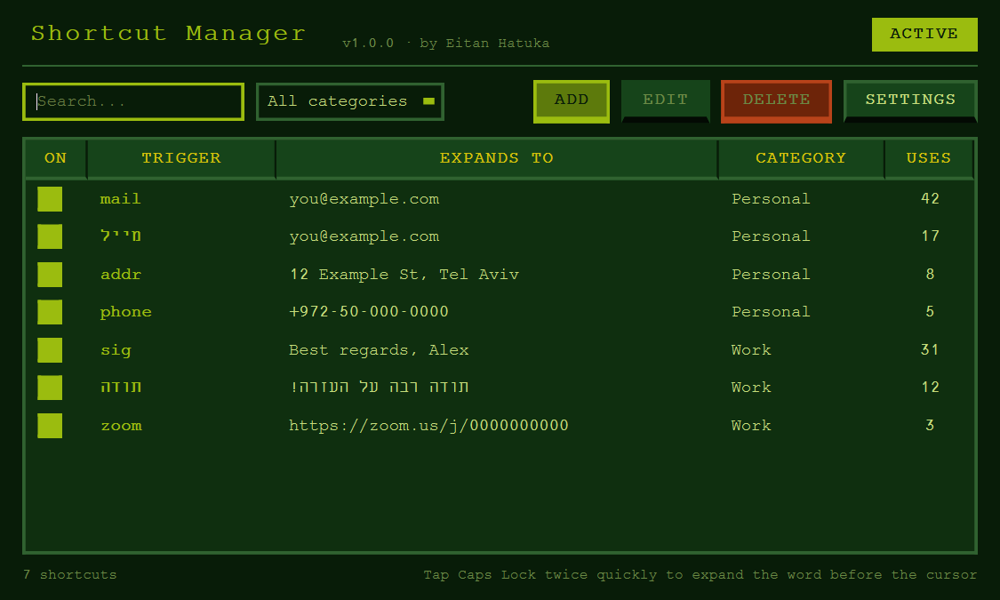
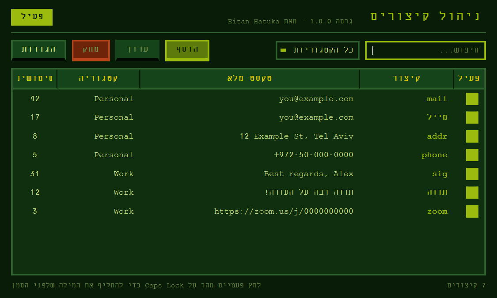

<p align="center">
  
</p>

<h1 align="center">ShWordCut</h1>

<p align="center">
  Type a short word, tap <b>Caps Lock</b> twice, and it becomes the full text.<br>
  A tiny retro text expander for Windows, in English and Hebrew.
</p>

<p align="center">
  <a href="../../releases/latest"><b>⬇ Download for Windows</b></a>
  &nbsp;·&nbsp; <a href="#עברית">עברית</a>
</p>

<p align="center">
  
</p>

## How it works

1. Save a shortcut, for example `mail` → `you@example.com`.
2. In any app, type `mail`.
3. Tap **Caps Lock** twice, quickly. `mail` is replaced by `you@example.com`.

It works everywhere you can type: browsers, Word, Slack, WhatsApp Desktop, Notepad, and so on.

## Features

- **Works in any app.** It edits the word right before your cursor.
- **English and Hebrew.** Shortcuts work in both languages, including mid-sentence and mixed text. The interface switches between the two.
- **Nothing runs while you type.** ShWordCut does not watch or record your keystrokes. It only waits for the double Caps Lock tap, then reads the single word before the cursor.
- **Light.** About 45 MB of RAM, sitting in the system tray.
- **Organised.** Categories, search, per-shortcut on/off, and usage counts.
- **Your choice of settings.** Exact or case-insensitive matching, typing or pasting, clipboard kept or overwritten, start with Windows.

## Install

1. Download `ShWordCut-Setup-x.y.z.exe` from the [latest release](../../releases/latest).
2. Run it. No administrator rights are needed.
3. The first time, Windows may show **"Windows protected your PC"**. This happens because the app is not code-signed, which costs money every year. Click **More info → Run anyway**.

To remove it, go to **Settings → Apps → Installed apps → ShWordCut → Uninstall**. Your shortcuts are kept in `%APPDATA%\ShWordCut`, so a reinstall picks them up again.

> **Antivirus warnings:** a few antivirus engines are suspicious of any program that listens for a keyboard shortcut. The complete source is in this repository, so you can check exactly what it does. See [`shwordcut/expander.py`](shwordcut/expander.py) and [`shwordcut/hotkey.py`](shwordcut/hotkey.py).

## Privacy

ShWordCut has no network code, sends nothing anywhere, and keeps no history of what you type. The keyboard hook only checks for Caps Lock. Every other key is passed straight through without being recorded.

When you double-tap, ShWordCut:

1. selects the word before the cursor (`Ctrl+Shift+←`),
2. copies it to find out what it is,
3. looks it up in your shortcut list,
4. types the replacement, or puts the cursor back where it was if there is no match.

Shortcuts and settings are plain JSON files in `%APPDATA%\ShWordCut`.

## Build from source

Requirements: Windows 10 or 11, Python 3.11+, and [Inno Setup 6](https://jrsoftware.org/isinfo.php) for the installer.

```powershell
# run from source
pip install -r requirements.txt
pythonw run.pyw

# build dist\ShWordCut-Setup-<version>.exe
powershell -ExecutionPolicy Bypass -File build.ps1
```

## License

[MIT](LICENSE)

---

<div dir="rtl" id="עברית">

## עברית

**ShWordCut** הוא מרחיב טקסט קטן ל-Windows בסגנון רטרו. מקלידים מילה קצרה, לוחצים פעמיים מהר על **Caps Lock**, והיא מתחלפת בטקסט המלא.

<p align="center">
  
</p>

### איך זה עובד

1. שומרים קיצור, למשל `מייל` → `you@example.com`.
2. בכל תוכנה מקלידים `מייל`.
3. לוחצים פעמיים מהר על **Caps Lock**, והמילה מתחלפת.

### התקנה

1. מורידים את `ShWordCut-Setup-x.y.z.exe` מ[הגרסה האחרונה](../../releases/latest).
2. מריצים. לא צריך הרשאות מנהל.
3. בפעם הראשונה Windows עשוי להציג **"Windows protected your PC"**, כי התוכנה לא חתומה דיגיטלית. לוחצים **More info ← Run anyway**.

### פרטיות

התוכנה לא מתחברת לאינטרנט, לא שולחת כלום, ולא שומרת היסטוריה של מה שמקלידים. היא מקשיבה רק ללחיצה הכפולה על Caps Lock, וקוראת רק את המילה האחת שלפני הסמן. כל הקוד פתוח כאן לבדיקה.

</div>
